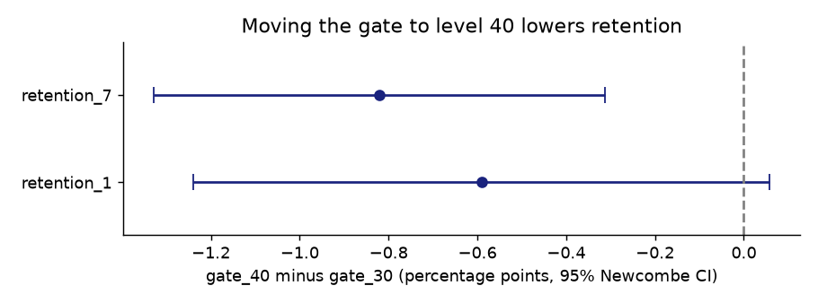

# Experiment analysis: Cookie Cats gate test

**Decision:** Should the first progression gate move from level 30 to level 40?

**Recommendation:** Keep level 30, but audit assignment first. Day-7 retention is −0.82 pp under gate_40 (95% Newcombe CI [−1.33, −0.31], p = 0.0016), but the sample-ratio-mismatch check fails (p = 0.0086).



| Check | Method | Result |
|---|---|---|
| SRM | χ² goodness of fit vs 50/50 | 44,700 vs 45,489, p = 0.0086 (**fail**) |
| Power | MDE at α = 0.05, 1−β = 0.8 | 0.74 pp on a 19.02% base (retention_7) |
| Primary: retention_7 | Pooled z-test + Newcombe CI | −0.82 pp [−1.33, −0.31] |
| Secondary: retention_1 | Same | −0.59 pp [−1.24, 0.06], p = 0.074 |
| Guardrail: game rounds | Mann-Whitney; bootstrap CI (mean winsorised at p99) | p = 0.050; [−1.30, 0.71] rounds |
| Segments (day-1 retained or not) | Holm-adjusted; conditional on a post-treatment variable, so not causal | Negative in both, p_holm ≥ 0.07 |
| Peeking | A/A simulation, 10 looks, 2,000 runs | False-positive rate 4.8% → 19.7% |

**Why I built this:** a reusable, tested toolkit for reading A/B tests correctly before making a product decision.

**Data:** [`data/cookie_cats.csv`](data/cookie_cats.csv), 90,189 players from Tactile Entertainment's *Cookie Cats* test, published with the DataCamp/Kaggle "Mobile Games A/B Testing" project ([mirror](https://raw.githubusercontent.com/ryanschaub/Mobile-Games-A-B-Testing-with-Cookie-Cats/master/cookie_cats.csv)).

## Run
```
pip install -r requirements.txt
pytest -q
jupyter nbconvert --to notebook --execute analysis.ipynb
```
`expkit/` is reusable: SRM, sample size and MDE, two-proportion test with Newcombe CI, bootstrap, Holm correction, segment table and peeking simulation.

**Limitations:**
- There are no pre-treatment covariates, so no CUPED or stratification.
- Retention is binary at day 1 and day 7 only.
- The cause of the SRM can't be diagnosed from this extract.

See [DESIGN.md](DESIGN.md).
